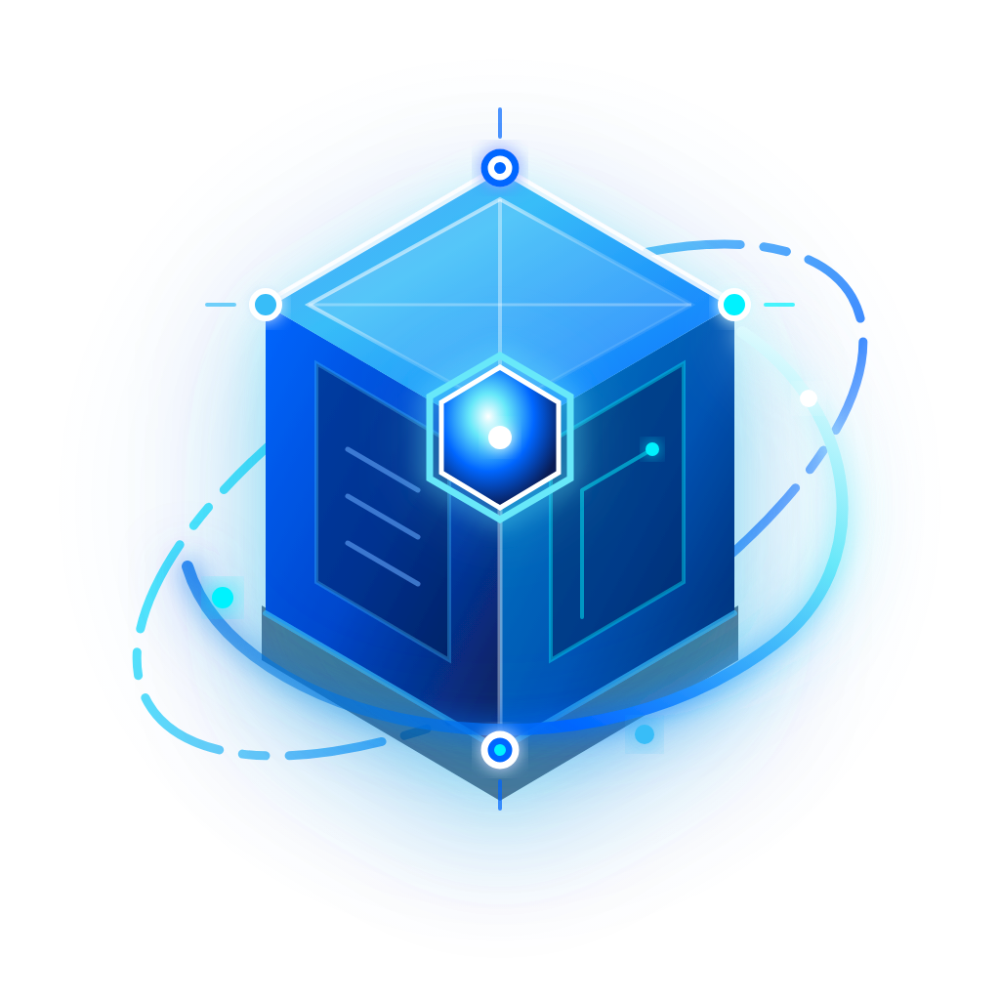
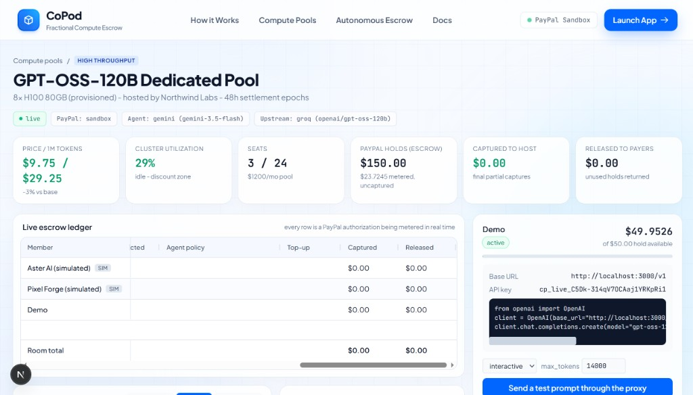
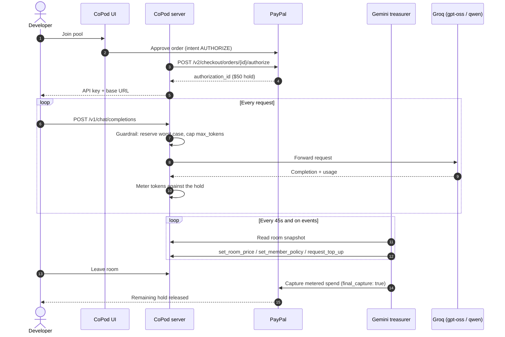
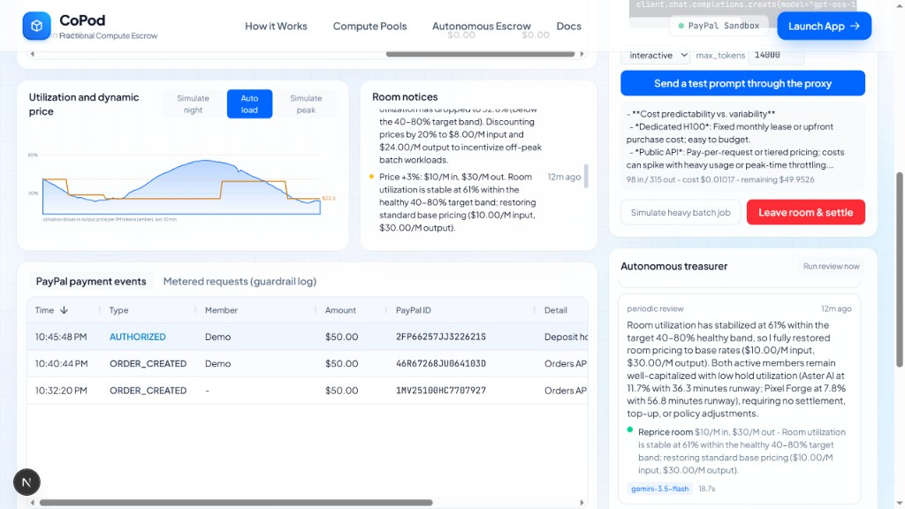
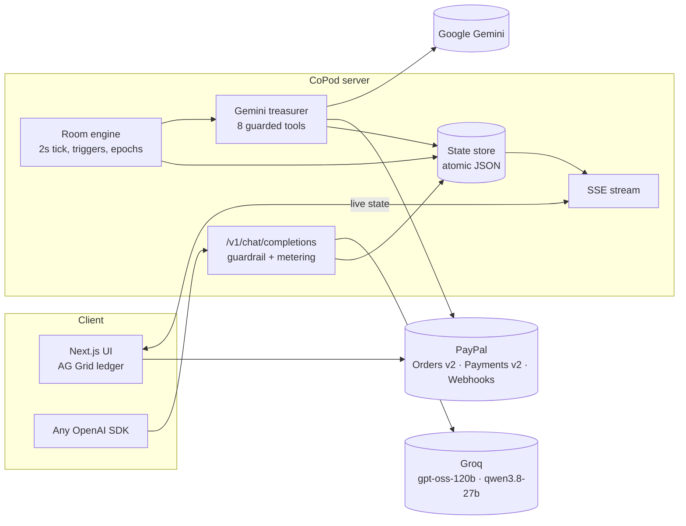

<div align="center">



# CoPod

### Fractional AI compute, escrowed by PayPal, settled by an autonomous agent.

Pool a dedicated GPU cluster with other teams. Every seat is a **PayPal authorization hold**, every token is metered against it, and a **Gemini treasurer** captures exactly what you used when you leave.

[](https://developer.paypal.com/docs/api/orders/v2/)
[](https://ai.google.dev/)
[](https://groq.com/)
[](https://www.ag-grid.com/)
[](https://nextjs.org/)
[](LICENSE)

[Quick start](#quick-start) · [How it works](#how-it-works) · [PayPal integration](#paypal-integration) · [The agent](#the-autonomous-treasurer) · [API](#use-it-from-code)

<br />



</div>

---

## Why CoPod

Dedicated inference capacity (an 8× H100 node, provisioned model throughput) costs **$1,000–$10,000+ per month** with long commitments. Solo developers and small startups can't justify it, so they live with rate-limited public APIs — while the teams that *do* rent clusters leave **50–70% of capacity idle** overnight.

Pooling the cluster is the obvious fix. What's missing is **trust between strangers**: Who pays for what? What if someone overspends? Who settles at the end, and how?

**CoPod answers that with PayPal's authorize → capture primitive and an AI agent that runs the books.**

| For developers | For compute hosts | For everyone |
| --- | --- | --- |
| Dedicated-cluster throughput, no monthly minimum | Sell idle capacity by the seat | Spend can **never** exceed the PayPal hold |
| OpenAI-compatible — change one base URL | Usage is backed by funds PayPal already reserved | Unused funds are released automatically |
| Pay only for metered tokens | Off-peak discounts fill idle hours | Every agent decision is logged and explainable |

## Features

- **PayPal escrow seats** — joining places a refundable authorization hold (`intent: AUTHORIZE`). Nothing is charged up front.
- **OpenAI-compatible proxy** — `/v1/chat/completions` with per-request token metering, streaming, and `x-copod-*` billing headers.
- **Overdraft guardrail** — before a prompt reaches the GPU, CoPod reserves the worst-case cost and caps `max_tokens` to what the remaining hold can pay for.
- **Autonomous Gemini treasurer** — reprices the room, throttles or pauses risky traffic, requests top-ups, verifies authorizations with PayPal, and settles members.
- **Exact partial capture** — on exit, the agent captures precisely the metered spend with `final_capture: true`; PayPal releases the rest.
- **Live escrow ledger** — AG Grid streams holds, spend, burn rate, runway, captures and releases over Server-Sent Events.
- **Host your own pool** — anyone can list a pool (model, seats, deposit, prices, capacity) and name their PayPal account as the payee, so captures land directly with the host.
- **Fail-safe by design** — hard limits in code, a model fallback chain, and a deterministic rules engine so money always settles correctly.

## How it works



<div align="center">

<br />
<sub>Utilization vs. agent-set price, real PayPal sandbox events, and the treasurer's reasoning feed.</sub>
</div>

## PayPal integration

CoPod uses the full authorization lifecycle, not just a checkout button.

| Stage | PayPal API | What CoPod does |
| --- | --- | --- |
| Checkout | JS SDK (`@paypal/react-paypal-js`, `intent=authorize`) | Buyer approves a hold in the PayPal popup |
| Hold | `POST /v2/checkout/orders` → `POST /v2/checkout/orders/{id}/authorize` | Seat + API key issued only after PayPal confirms |
| Top-up | New authorize order | Agent requests one at 85% of the hold |
| Verify | `GET /v2/payments/authorizations/{id}` | Agent checks hold status before acting |
| Settle | `POST /v2/payments/authorizations/{id}/capture` with `final_capture: true` | Partial capture of exactly the metered spend |
| Release | `POST /v2/payments/authorizations/{id}/void` | Unused authorizations are voided |
| Events | Webhooks + `/v1/notifications/verify-webhook-signature` | Signature-verified payment events in the ledger |

- **Idempotent** — every mutating call carries a `PayPal-Request-Id`.
- **Honor-period aware** — 48-hour settlement epochs stay inside PayPal's 3-day authorization honor period.
- **Payee-aware** — orders can name the pool host as payee, so captures land directly in the host's account.

## The autonomous treasurer

The treasurer is a Gemini function-calling agent. It doesn't just apply thresholds — it reads the whole room (utilization trend, each member's burn rate, runway, hold usage, batch share) and decides which tools to call, explaining every decision.

| Tool | Hard limit enforced in code |
| --- | --- |
| `get_room_snapshot`, `get_member_activity` | Read-only |
| `set_room_price` | 0.6×–1.4× of base price, max 30% change per step |
| `set_member_policy` | `throttled` caps 64–4096 tokens; `suspended` only when the hold is exhausted |
| `request_top_up` | $10–$200 |
| `verify_paypal_authorization` | Read-only call to PayPal |
| `settle_member` | Capture ≤ metered spend and ≥ 80% of it; any credit needs a written reason |
| `broadcast_notice` | Posts to the room and an optional webhook |

**Triggers:** periodic reviews, utilization leaving the 30–85% band, members crossing 85% of their hold, short runway, exhausted holds, member exit, and epoch end.

**Safety:** the model can only act through these tools; it never touches PayPal directly. If Gemini is unavailable it falls back through `gemini-3.5-flash` → `gemini-2.5-flash` → `gemini-flash-lite-latest`, then to a deterministic rules engine.

## Architecture



## Tech stack

| Layer | Technology |
| --- | --- |
| App | Next.js 16 (App Router, Turbopack), React 19, TypeScript |
| Styling | Tailwind CSS v4, glassmorphism design system |
| Payments | PayPal Orders v2, Payments v2, Webhooks, JS SDK (sandbox) |
| AI agent | Google Gemini via `@google/genai` (function calling) |
| Inference | Groq OpenAI-compatible API (`openai/gpt-oss-120b`, `openai/gpt-oss-20b`, `qwen/qwen3.8-27b`) |
| Data grid | AG Grid Community (live ledger, payments, request log) |
| Realtime | Server-Sent Events |
| Hosting | Render (`render.yaml` blueprint) |

## Quick start

**Prerequisites:** Node.js 20+, a [PayPal Developer](https://developer.paypal.com/) sandbox app, a [Gemini API key](https://aistudio.google.com/apikey), and a [Groq API key](https://console.groq.com/keys).

```bash
git clone https://github.com/Krixna-Kant/CoPod.git
cd CoPod
npm install
cp .env.example .env.local   # add your keys
npm run dev                  # http://localhost:3000
```

| Variable | Required | Purpose |
| --- | --- | --- |
| `PAYPAL_CLIENT_ID` / `PAYPAL_CLIENT_SECRET` | Yes | Sandbox REST app credentials |
| `PAYPAL_ENV` | Yes | `sandbox` |
| `GEMINI_API_KEY` | Yes | Autonomous treasurer |
| `GROQ_API_KEY` | Yes | Inference upstream |
| `GEMINI_MODEL` | No | Defaults to `gemini-3.5-flash` |
| `PAYPAL_WEBHOOK_ID` | No | Enables webhook signature verification |
| `PAYPAL_HOST_PAYEE_EMAIL` | No | Route captures to a specific host account |
| `NOTIFY_WEBHOOK_URL` | No | Forward agent notices (e.g. Slack/Discord) |

> Without PayPal keys, CoPod runs in a clearly labelled **mock mode** so you can explore the full flow offline.

### Try the full lifecycle

1. Open a pool and click the PayPal button. Approve with a **US Personal sandbox** account.
2. Copy your API key and send prompts from the dashboard or your own code.
3. Click **Simulate peak** / **Simulate night** and watch the treasurer reprice the room.
4. Click **Leave room & settle**. Confirm the partial capture and released balance in the **Business sandbox** account at [sandbox.paypal.com](https://www.sandbox.paypal.com/).

## Use it from code

CoPod is a drop-in OpenAI endpoint — change the base URL and key.

```python
from openai import OpenAI

client = OpenAI(base_url="http://localhost:3000/v1", api_key="cp_live_...")

r = client.chat.completions.create(
    model="gpt-oss-120b",
    messages=[{"role": "user", "content": "Summarize PayPal authorization holds."}],
)
print(r.choices[0].message.content)
print(r.copod)  # tokens, cost, remaining hold, applied max_tokens cap
```

**Postman:** import [`postman/CoPod.postman_collection.json`](postman/CoPod.postman_collection.json) to run the whole lifecycle — create pool → join → PayPal AUTHORIZE order → metered chat → agent review → leave & settle. Test scripts chain `roomId`, `memberId`, `orderId` and `apiKey` automatically.

| Header | Meaning |
| --- | --- |
| `x-copod-priority: batch` | Mark traffic as batch (eligible for off-peak pricing; paused first at peak) |
| `x-copod-cost-usd` | Cost of this request in USD |
| `x-copod-remaining-usd` | Hold remaining after this request |
| `x-copod-granted-max-tokens` | Guardrail cap applied to this request |
| `x-copod-price-per-m` | Input/output price per million tokens at request time |

## Project structure

```
src/
├─ app/
│  ├─ page.tsx                     # Landing page (live data)
│  ├─ rooms/[roomId]/              # Room dashboard
│  ├─ docs/                        # Developer docs
│  ├─ api/rooms/…                  # Join, state, SSE stream, agent, simulator
│  ├─ api/paypal/…                 # Orders, authorize, webhook
│  └─ v1/chat/completions/         # OpenAI-compatible metered proxy
├─ lib/
│  ├─ paypal.ts                    # PayPal REST client
│  ├─ metering.ts                  # Guardrail + usage recording
│  ├─ ledger.ts                    # Holds, spend, runway, utilization
│  ├─ engine.ts                    # Room engine and agent triggers
│  └─ agent/                       # Gemini treasurer, tools, snapshots
└─ components/                     # Dashboard, AG Grid ledgers, charts
```

## Roadmap

- Host onboarding via PayPal partner referrals (verified payee accounts)
- Real GPU backends (vLLM / provisioned throughput) behind the same metering layer
- Multi-currency pools and PayPal Vault for recurring members
- Agent-to-agent buying: autonomous AI clients that join and pay for pools

## License

[MIT](LICENSE) — built for the PayPal AI Hackathon. Sandbox only; no real funds move.
